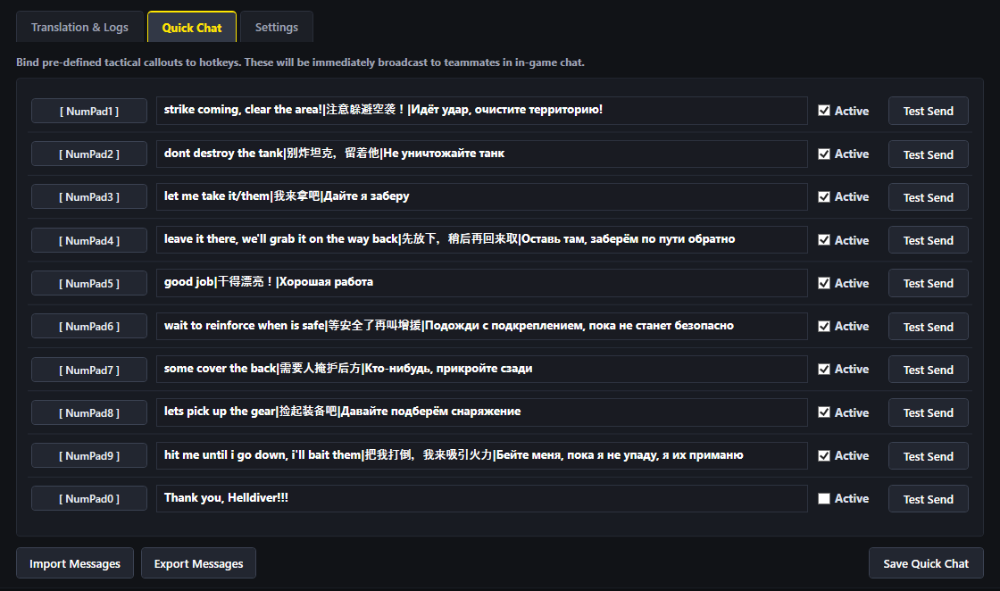
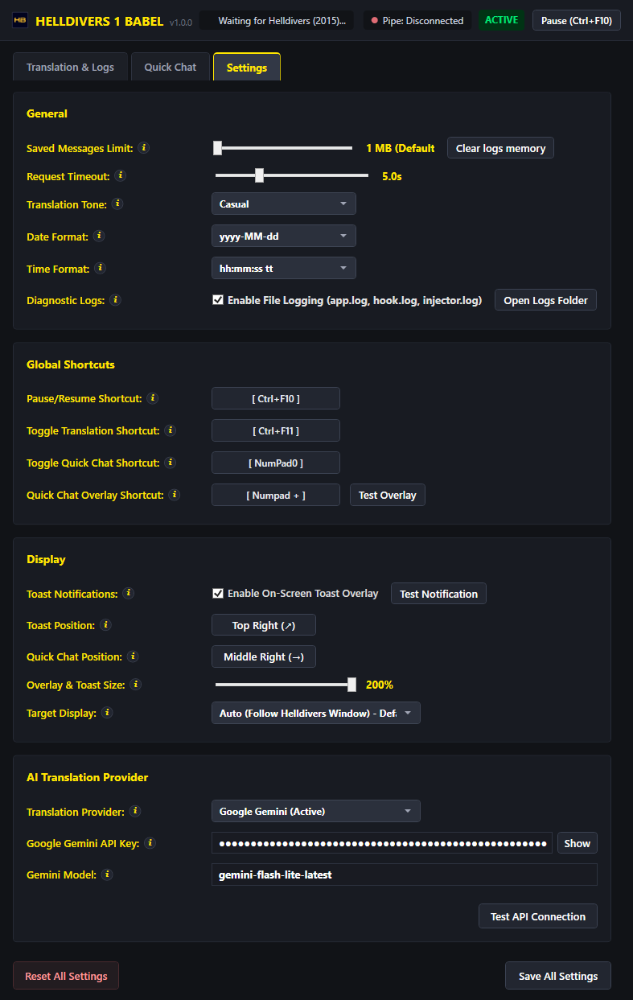

# 

[](https://github.com/difinim/helldivers1-babel/releases/latest)
[](https://github.com/difinim/helldivers1-babel/actions/workflows/release.yml)
[](https://github.com/difinim/helldivers1-babel/actions/workflows/tests.yml?query=branch%3Amain)
[](https://github.com/difinim/helldivers1-babel/actions/workflows/codeql.yml?query=branch%3Amain)
[](https://github.com/difinim/helldivers1-babel/actions/workflows/osv-scanner.yml?query=branch%3Amain)
[](https://github.com/difinim/helldivers1-babel/network/updates)

*Dive together. Speak as one.*

**Helldivers 1 Babel** is an open-source, non-invasive chat translation and tactical communication assistant for *Helldivers (2015)*, because *sweet liberty sounds better when everyone understands the plan*.
> [!IMPORTANT]
> **Compatibility Disclaimer:**
> **Helldivers 1 Babel is strictly developed for Helldivers (2015) on PC (Steam).**
> **It is NOT compatible with Helldivers 2 (2024)**, which is completely different and uses kernel-level anti-cheat.


## 1. Overview & Key Features

- **Real-Time Bidirectional Chat Translation:**
  - **Incoming Messages:** Automatically detects teammates' language, translates messages into your chosen target language (supports up to 28 target languages, including Portuguese PT-BR, English, Spanish, Russian, Chinese, Japanese, French, German, and more), and renders them into the in-game chat while **faithfully preserving the original teammate's player name and color code** (P1 Gold, P2 Blue, P3 Purple, P4 Cyan).
  - **Outgoing Messages:** Type `[target_language]>>message` or simply `>>message` to auto-reply in the language of the last incoming teammate message. Translated text is broadcasted over multiplayer RPC so international teammates read it natively.
- **Persistent Chat Logs & File Export:** Full session chat history tracking with timestamps, player names, colors, detected source languages, and translation latency. Logs persist in the table across application restarts via lightweight asynchronous batch disk writes (configurable), with one-click export to a `.txt` file.


- **Tactical Quick Chat (10 Custom Slots):** 10 customizable pre-defined tactical message slots, each bound to user-configurable hotkeys (e.g. Numpad 0-9 or custom combinations) to instantly transmit tactical callouts into in-game multiplayer chat.



- **On-Screen Quick Chat Reference Overlay:** Toggle a non-activating floating reference overlay on the right side of the screen with `Numpad +` (or your recorded shortcut) to quickly inspect all active tactical callouts and shortcuts in-game. *(Requires Helldivers to run in Borderless Fullscreen or Windowed mode).*


- **Provider Adapter Architecture:** Built with a modular AI provider interface. Comes with an optimized, zero-thinking adapter for **Google Gemini** (`gemini-flash-lite-latest` / `gemini-2.0-flash-lite`), with extensible provider contracts for OpenAI, Claude, and DeepSeek (not implemented yet).
- **Global Pause / Resume Hotkey:** Press `Ctrl + F10` (or your configured shortcut) anytime to toggle the assistant between **Active** and **Paused**. Pausing cleanly suspends both in-game chat translation and Quick Chat message broadcasts.
- **Dedicated Feature Hotkeys:**
  - **Toggle Translation Only:** Press `Ctrl + F11` (or your recorded shortcut) to instantly pause or resume chat translation without affecting Quick Chat (with on-screen toast feedback).
  - **Toggle Quick Chat Only:** Press `Ctrl + F12` (or your recorded shortcut) to instantly pause or resume Quick Chat callouts without affecting translation (with on-screen toast feedback).



- **Secure Credential Storage (DPAPI):** Sensitive preferences like AI provider API tokens are encrypted at rest using the Windows Data Protection API (DPAPI, `CurrentUser` scope). Credentials are never stored in plaintext in configuration files and can only be decrypted on your local machine by your Windows account.
- **Zero Telemetry & Complete Privacy:** This tool does not collect, log, or send any user data or telemetry data. All translation requests communicate directly and exclusively with your configured AI provider endpoint using your personal API credentials.
- **100% Non-Invasive (Zero Game File Modification):** No game archives are unpacked or modified. Your game files remain 100% vanilla and untampered.

### Download & Installation (Pre-Built Release)

You do **not** need to install developer tools or compile from source to use Babel:
1. Navigate to the **[Releases](https://github.com/difinim/helldivers1-babel/releases)** section on the right side of the GitHub project page.
2. Under the latest release (e.g. `v1.0.0`), expand the **Assets** list.
3. Download the standalone distribution archive: **`Helldivers1Babel-v<version>-win-x64.zip`**.
4. Extract the zip file anywhere on your computer (e.g. `C:\Games\Helldivers1Babel`).
5. Open the folder and run **`HD1-Babel.exe`**.

> [!NOTE]
> **Prerequisite:** End-users only need the free [Microsoft .NET 10 Desktop Runtime (x64)](https://dotnet.microsoft.com/download/dotnet/10.0). No C++ compiler, SDK, or toolchain is required to run the release.

> [!NOTE]
> **Be aware**: Because InjectorService.cs uses standard Windows process injection APIs (`VirtualAllocEx` + `WriteProcessMemory` + `CreateRemoteThread`), Windows Defender or third-party Antivirus _**may**_ trigger a heuristic detection (e.g. Generic HackTool). This is normal behavior for game mod injectors and can be safely allowlisted.


## 2. Usage Guide

### Getting Started
1. Start **Helldivers 1 Babel** (`HD1-Babel.exe`).
2. On first launch, open the **Settings** tab:
   - Enter your **Google Gemini API Key** (safely stored via Windows DPAPI encryption).
   - Select your target language (e.g. `Portuguese (PT-BR)`).
   - Click **Test API Connection** to verify your key and latency.
   - Customize the **Pause / Resume** shortcut if desired (defaults to `Ctrl + F10`).
3. Configure your tactical callouts in the **Quick Chat** tab (e.g. bind Numpad 0-9 to your preferred messages).
4. Launch **Helldivers** on Steam. Babel automatically detects `helldivers.exe`, injects `BabelHook.dll`, and establishes high-speed named pipe IPC.

### In-Game Communication & Use Cases

#### 1. Automatic Incoming Translation
Incoming messages from teammates are detected and translated into your target language on-the-fly, displayed in in-game chat with the original player's name and color:
- Teammate (English): `so quiet`
- In-Game Chat: `Diveheller: (English): mó silêncio`

#### 2. Auto-Reply to Last Incoming Language (`>>message`)
Prefixing your chat message with `>>` automatically translates your text into the language of the last incoming teammate message:
- Your input in chat: `>>sim, está calmo demais`
- Teammate sees: `yes, it is too quiet`

#### 3. Explicit / Arbitrary Language Selection (`target language>>message`)
Direct your message to a specific language at any time by prefixing it with the language name followed by `>>`:

| Chat Input Command | Target Language | Example Result Broadcasted to Teammates |
| :--- | :--- | :--- |
| `russian>>bom dia!` | Russian | `доброе утро!` |
| `english>>minas ao norte` | English | `mines to the north` |
| `japanese>>cuidado com os tiros!` | Japanese | `射線に注意せよ！` |
| `spanish>>preciso de munição` | Spanish | `necesito munición` |
| `german>>recuem para o ponto de extração` | German | `Rückzug zum Extraktionspunkt` |
| `french>>vamos defender aqui` | French | `défendons cette position` |

#### 4. Standard Outgoing Messages & Self-Translation Suppression
When typing a standard in-game chat message without `>>` (e.g. `need ammo`, `vamos lá`), your message is transmitted directly over vanilla multiplayer chat. With the **"Don't translate standard outgoing"** toggle enabled (ON by default in both the quick controls bar and Settings), Babel suppresses translating your own message back to you. If toggled OFF, Babel will process standard local messages through the incoming translation pipeline as well.

#### 5. Tactical Quick Chat Shortcuts
Press any configured quick chat hotkey (e.g., `NumPad 1`-`NumPad 9`) while playing to instantly broadcast preset callouts into multiplayer chat without opening the chat prompt. All keypresses seamlessly pass through to the game, ensuring your controls remain responsive.

#### 6. Tactical Quick Chat Reference Overlay (`Numpad +`)
Press `Numpad +` (or your recorded shortcut configured in the **Quick Chat** tab) at any time to toggle an on-screen reference overlay listing all active Quick Chat presets. The overlay appears right-aligned and centered vertically on the screen, showing each active preset in the pattern `[<shortcut>] <message>` (with messages truncated to 30 characters) using the same non-intrusive visual style as toasts.
> [!NOTE]
> **Display Mode Requirement:** Helldivers must be configured to run in **Borderless Fullscreen** (or Windowed) mode in the in-game Video settings for Windows overlay windows to render over the game.

#### 7. Pause, Resume & Feature Toggles
- **Global Pause / Resume (`Ctrl + F10`):** Master switch that cleanly suspends/resumes both translation interception and Quick Chat message broadcasting.
- **Toggle Translation Only (`Ctrl + F11`):** Toggles only the translation feature on or off with an on-screen toast notification. Quick Chat continues functioning normally.
- **Toggle Quick Chat Only (`Ctrl + F12`):** Toggles only Quick Chat message broadcasting on or off with an on-screen toast notification. In-game chat translation continues functioning normally.
*(All shortcuts can be customized in the **Settings** and **Quick Chat** tabs using the click-to-record shortcut buttons).*

#### 8. Exporting & Persistent Chat Logs
Click **Export Logs** in the Translation & Logs tab at any time to choose a location and export your chat history (with timestamps, player names, original messages, translations, and latencies) to a `.txt` document. Chat messages automatically persist in the table across app launches via asynchronous batch disk writes (storage limit is configurable from 0 to 100 MB in Settings, with a **Clear logs memory** button).

#### 9. Interactive Message Links
Squad chat messages containing `http://` or `https://` URLs are rendered as clickable links in the **Original Message** column. When clicked, a confirmation dialog prompts you to verify if you trust the link before opening it in your default web browser.


## 3. System Requirements

### Running the Tool (End-User Requirements)
If you are running the pre-compiled standalone release (`HD1-Babel.exe`):
- **Operating System:** Windows 10 / 11 64-bit (x64).
- **Desktop Runtime:** [Microsoft .NET 10 Desktop Runtime (x64)](https://aka.ms/dotnet/10.0/windowsdesktop-runtime-win-x64.exe) (direct installer).
- **Target Game:** *Helldivers* (2015) on Steam (64-bit `helldivers.exe`).
- **AI Provider Credentials:** Google Gemini API Key (obtain free personal key from [Google AI Studio](https://aistudio.google.com/)).
- **Internet Access:** Required for translation API calls.

### Building from Source (Developer Requirements)
If you are compiling and building the project from source:
- **Operating System:** Windows 10 / 11 64-bit (x64).
- **.NET 10 SDK:** [.NET 10 SDK](https://dotnet.microsoft.com/download/dotnet/10.0) (`net10.0-windows`).
- **MSYS2 MinGW64 Toolchain (Clang++ & LuaJIT):** [MSYS2](https://www.msys2.org/) with `mingw-w64-x86_64-clang`, `mingw-w64-x86_64-gcc`, and `mingw-w64-x86_64-luajit` packages - required for compiling the native hook library (`BabelHook.dll`) and compiling the in-game bootstrap script (`babel_bootstrap.lua`) into bytecode.
- **Git:** Git for Windows (with recursive submodules for MinHook amalgamation).


## 4. Quick Start & Setup

### Running the Pre-Built Release (End Users)
1. Download the latest release package (`Helldivers1Babel-vX.X.X-win-x64.zip`) from [GitHub Releases](https://github.com/difinim/helldivers1-babel/releases).
2. Extract the archive to any folder on your computer.
3. Install the [.NET 10 Desktop Runtime (x64)](https://aka.ms/dotnet/10.0/windowsdesktop-runtime-win-x64.exe) if not already installed.
4. Launch `HD1-Babel.exe` and follow the [Usage Guide](#2-usage-guide).

### Building from Source (Developers)

#### Automated Environment Setup
Double-click `setup.bat` (or run `setup.ps1` in PowerShell) in the repository root. It automatically verifies and installs missing prerequisites:
1. Verifies 64-bit Windows environment.
2. Checks for .NET 10 SDK (auto-installs via `winget` if missing).
3. Checks for the MSYS2 MinGW64 toolchain (Clang++, GCC, and LuaJIT). If missing, auto-installs MSYS2 via `winget` and installs the required packages (`mingw-w64-x86_64-clang`, `mingw-w64-x86_64-gcc`, and `mingw-w64-x86_64-luajit`) via `pacman`.
4. Automatically ensures `C:\msys64\mingw64\bin` and `C:\msys64\usr\bin` are added to PATH.
5. Verifies MinHook amalgamation dependencies and runs an initial build sanity check.

#### Master Build & Release Packaging
To clean previous artifacts, compile the native hook DLL, run all unit tests, and assemble the release package:
```powershell
pwsh -File build.ps1
```
The output directory will be packaged into `dist/Helldivers1Babel-v1.0.0/`.

#### Manual Step-by-Step Build
```powershell
# 1. Build the native hook DLL (automatically compiles babel_bootstrap.lua with luajit)
pwsh -File src/Babel.Hook/build.ps1

# 2. Build the .NET 10 solution
dotnet build Helldivers1Babel.slnx

# 3. Run automated test suites
dotnet test
```


## 5. License

Distributed under the [MIT License](LICENSE).
