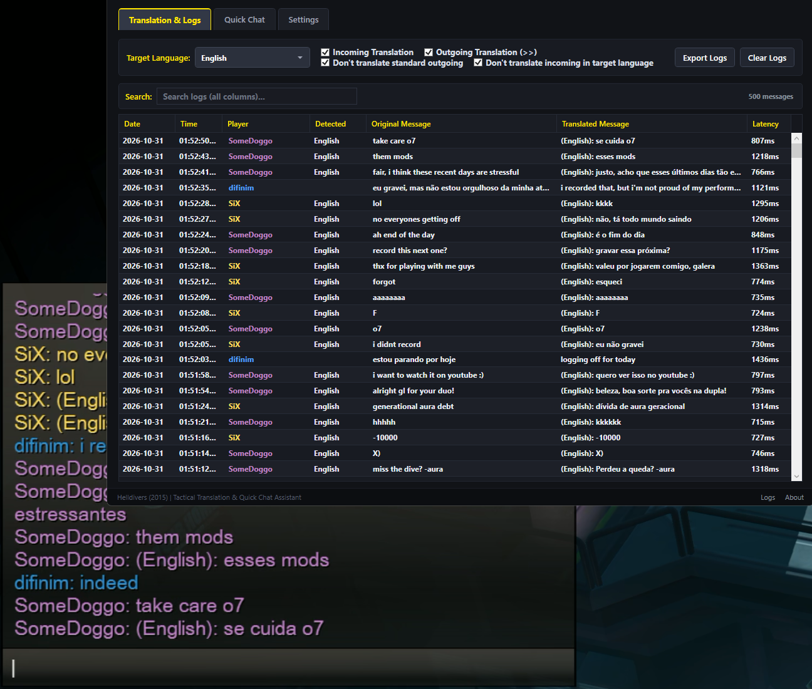
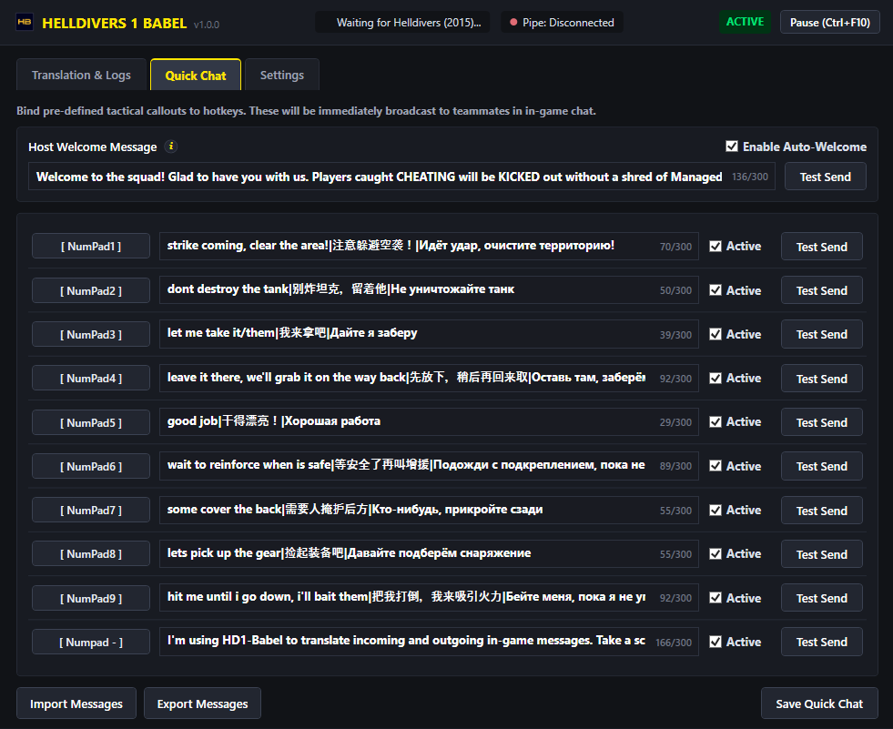
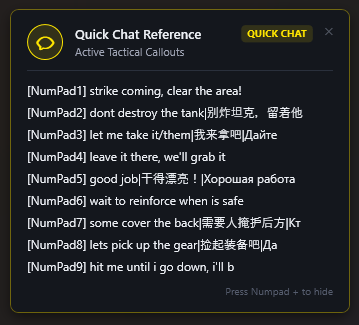

# 

[](https://github.com/difinim/helldivers1-babel/releases/latest)
[](https://github.com/difinim/helldivers1-babel/actions/workflows/release.yml)
[](https://github.com/difinim/helldivers1-babel/actions/workflows/tests.yml?query=branch%3Amain)
[](https://github.com/difinim/helldivers1-babel/actions/workflows/codeql.yml?query=branch%3Amain)
[](https://github.com/difinim/helldivers1-babel/actions/workflows/osv-scanner.yml?query=branch%3Amain)
[](https://github.com/difinim/helldivers1-babel/network/updates)

*साथ मिलकर उतरें। एक स्वर में बोलें।*

**Helldivers 1 Babel** *Helldivers (2015)* के लिए एक ओपन-सोर्स, गैर-आक्रामक चैट अनुवाद और सामरिक संचार सहायक है, क्योंकि *जब हर कोई योजना समझता है, तो प्यारी आज़ादी और भी बेहतर लगती है*।

## Translations

[English](../README.md) | [العربية](README.ar.md) | [বাংলা](README.bn.md) | [简体中文](README.zh.md) | [Čeština](README.cs.md) | [Nederlands](README.nl.md) | [Français](README.fr.md) | [Deutsch](README.de.md) | [Ελληνικά](README.el.md) | [हिन्दी](README.hi.md) | [Magyar](README.hu.md) | [Bahasa Indonesia](README.id.md) | [Italiano](README.it.md) | [日本語](README.ja.md) | [한국어](README.ko.md) | [Bahasa Melayu](README.ms.md) | [فارسی](README.fa.md) | [Polski](README.pl.md) | [Português (PT-BR)](README.pt-BR.md) | [Română](README.ro.md) | [Русский](README.ru.md) | [Español](README.es.md) | [Svenska](README.sv.md) | [Tagalog (Filipino)](README.tl.md) | [ไทย](README.th.md) | [Türkçe](README.tr.md) | [Українська](README.uk.md) | [Tiếng Việt](README.vi.md)

> [!IMPORTANT]
> **संगतता अस्वीकरण:**
> **Helldivers 1 Babel विशेष रूप से PC (Steam) पर Helldivers (2015) के लिए विकसित किया गया है।**
> **यह मॉड्स (mods) के साथ संगत है।**
> **यह Helldivers 2 (2024) के साथ संगत नहीं है**, जो पूरी तरह से अलग है और कर्नेल-स्तरीय एंटी-चीट का उपयोग करता है।

## विषय-सूची

- [1. विहंगावलोकन और मुख्य विशेषताएं](#1-विहंगावलोकन-और-मुख्य-विशेषताएं)
- [2. सेटअप](#2-सेटअप)
  - [आवश्यकताएं](#आवश्यकताएं)
  - [निःशुल्क AI API कुंजी सेट करें](#निःशुल्क-ai-api-कुंजी-सेट-करें)
  - [डाउनलोड और इंस्टॉलेशन (पूर्व-निर्मित रिलीज़)](#डाउनलोड-और-इंस्टॉलेशन-पूर्व-निर्मित-रिलीज़)
- [3. उपयोग मार्गदर्शिका](#3-उपयोग-मार्गदर्शिका)
  - [शुरुआत करना](#शुरुआत-करना)
  - [गेम में संचार और उपयोग के मामले](#गेम-में-संचार-और-उपयोग-के-मामले)
- [4. विकास (स्रोत से निर्माण)](#4-विकास-स्रोत-से-निर्माण)
  - [डेवलपर आवश्यकताएं](#डेवलपर-आवश्यकताएं)
  - [स्वचालित वातावरण सेटअप](#स्वचालित-वातावरण-सेटअप)
  - [मास्टर बिल्ड और रिलीज़ पैकेजिंग](#मास्टर-बिल्ड-और-रिलीज़-पैकेजिंग)
  - [मैनुअल चरण-दर-चरण बिल्ड](#मैनुअल-चरण-दर-चरण-बिल्ड)
- [5. लाइसेंस](#5-लाइसेंस)

## 1. विहंगावलोकन और मुख्य विशेषताएं

- **रीयल-टाइम द्विदिशी चैट अनुवाद:**
  - **आने वाले संदेश:** टीम के साथियों की भाषा का स्वतः पता लगाता है, संदेशों को आपकी चुनी हुई लक्ष्य भाषा में अनुवादित करता है (28 लक्ष्य भाषाओं तक का समर्थन करता है, जिनमें पुर्तगाली PT-BR, अंग्रेज़ी, स्पैनिश, रूसी, चीनी, जापानी, फ़्रेंच, जर्मन और अन्य शामिल हैं), और उन्हें इन-गेम चैट में **स्थानीय रूप से** प्रस्तुत करता है, जबकि **मूल साथी के खिलाड़ी नाम और रंग कोड को पूरी तरह बनाए रखता है** (P1 गोल्ड, P2 ब्लू, P3 पर्पल, P4 सियान)।
  - **जाने वाले संदेश:** अंतिम आने वाले साथी के संदेश की भाषा में स्वतः उत्तर देने के लिए `[target_language]>>संदेश` या केवल `>>संदेश` टाइप करें। अनुवादित पाठ मल्टीप्लेयर RPC के माध्यम से प्रसारित होता है ताकि अंतर्राष्ट्रीय साथी इसे अपनी भाषा में पढ़ सकें।
- **स्थायी चैट लॉग्स और फ़ाइल निर्यात:** टाइमस्टैम्प, खिलाड़ी का नाम, रंग, पहचानी गई स्रोत भाषा और अनुवाद विलंबता के साथ पूर्ण सत्र चैट इतिहास ट्रैकिंग। हल्के एसिंक्रोनस बैच डिस्क राइट्स (कॉन्फ़िगर करने योग्य) के माध्यम से एप्लिकेशन पुनः आरंभ करने पर भी लॉग तालिका में बने रहते हैं, और एक क्लिक में `.txt` फ़ाइल में निर्यात किए जा सकते हैं।
- **खोजने योग्य चैट लॉग्स:** पूरी तरह से खोजने योग्य चैट इतिहास जो किसी भी स्तंभ को फ़िल्टर करता है।



- **सामरिक त्वरित चैट (10 कस्टम स्लॉट):** 10 अनुकूलन योग्य पूर्व-निर्धारित सामरिक संदेश स्लॉट, जिनमें से प्रत्येक उपयोगकर्ता-कॉन्फ़िगर करने योग्य हॉटकीज़ (उदा. Numpad 0-9 या कस्टम संयोजन) से जुड़ा है, ताकि इन-गेम मल्टीप्लेयर चैट में तुरंत सामरिक कॉलआउट प्रेषित किए जा सकें।
- **स्वचालित स्वागत त्वरित चैट संदेश:** जब आप लॉबी की मेज़बानी कर रहे हों और कोई नया खिलाड़ी जुड़ता है, तो स्वचालित रूप से इन-गेम चैट में एक अनुकूलन योग्य स्वागत संदेश प्रसारित करता है।



- **ऑन-स्क्रीन त्वरित चैट संदर्भ ओवरले:** गेम में सभी सक्रिय सामरिक कॉलआउट और शॉर्टकट को तुरंत देखने के लिए `Numpad +` (या आपके रिकॉर्ड किए गए शॉर्टकट) से स्क्रीन के दाईं ओर एक गैर-सक्रिय फ्लोटिंग संदर्भ ओवरले टॉगल करें। *(Helldivers को बॉर्डरलेस फ़ुलस्क्रीन या विन्डोड मोड में चलना आवश्यक है)*।



- **बहुभाषी UI समर्थन:** 28 भाषाओं का समर्थन करता है।
- **प्रदाता एडेप्टर आर्किटेक्चर:** मॉड्यूलर AI प्रदाता इंटरफ़ेस के साथ निर्मित। **Google Gemini** (`gemini-flash-lite-latest` / `gemini-2.0-flash-lite`) के लिए अनुकूलित, ज़ीरो-थिंकिंग एडेप्टर के साथ आता है, जिसमें OpenAI, Claude और DeepSeek के लिए एक्स्टेंसिबल प्रदाता अनुबंध शामिल हैं (अभी कार्यान्वित नहीं हैं)।
- **अनुवाद शैली सेटिंग:** अनौपचारिक: अनौपचारिक गेमिंग स्लैंग और सामरिक गेमर भाषा / सामान्य: गेमिंग स्लैंग के बिना स्वाभाविक संवादात्मक शैली।
- **ग्लोबल रोकें / जारी रखें हॉटकी:** सहायक को **सक्रिय** और **रुका हुआ** के बीच टॉगल करने के लिए किसी भी समय `Ctrl + F10` (या आपका कॉन्फ़िगर किया गया शॉर्टकट) दबाएं। रोकने पर इन-गेम चैट अनुवाद और त्वरित चैट संदेश प्रसारण दोनों सुचारू रूप से निलंबित हो जाते हैं।
- **समर्पित सुविधा हॉटकीज़:**
  - **केवल अनुवाद टॉगल करें:** त्वरित चैट को प्रभावित किए बिना चैट अनुवाद को तुरंत रोकने या फिर से शुरू करने के लिए `Ctrl + F11` (या आपका रिकॉर्ड किया गया शॉर्टकट) दबाएं (ऑन-स्क्रीन टोस्ट फ़ीडबैक के साथ)।
  - **केवल त्वरित चैट टॉगल करें:** अनुवाद को प्रभावित किए बिना त्वरित चैट कॉलआउट को तुरंत रोकने या फिर से शुरू करने के लिए `Ctrl + F12` (या आपका रिकॉर्ड किया गया शॉर्टकट) दबाएं (ऑन-स्क्रीन टोस्ट फ़ीडबैक के साथ)।


- **सुरक्षित क्रेडेंशियल स्टोरेज (DPAPI):** AI प्रदाता API टोकन जैसी संवेदनशील प्राथमिकताएं Windows Data Protection API (DPAPI, `CurrentUser` स्कोप) का उपयोग करके एन्क्रिप्ट की जाती हैं। क्रेडेंशियल्स को कॉन्फ़िगरेशन फ़ाइलों में कभी भी प्लेनटेक्स्ट में संग्रहीत नहीं किया जाता है और इन्हें केवल आपके स्थानीय कंप्यूटर पर आपके Windows खाते द्वारा ही डिक्रिप्ट किया जा सकता है।
- **ज़ीरो टेलीमेट्री और पूर्ण गोपनीयता:** यह उपकरण किसी भी उपयोगकर्ता डेटा या टेलीमेट्री डेटा को एकत्र, लॉग या प्रेषित नहीं करता है। सभी अनुवाद अनुरोध आपके व्यक्तिगत API क्रेडेंशियल्स का उपयोग करके सीधे और विशेष रूप से आपके कॉन्फ़िगर किए गए AI प्रदाता एंडपॉइंट के साथ संचार करते हैं।
- **100% गैर-आक्रामक (गेम फ़ाइलों में कोई बदलाव नहीं):** कोई भी गेम आर्काइव अनपैक या संशोधित नहीं किया जाता है। आपकी गेम फ़ाइलें 100% वैनिला और अपरिवर्तित रहती हैं।


## 2. सेटअप

### आवश्यकताएं
यदि आप पूर्व-संकलित स्टैंडअलोन रिलीज़ (`HD1-Babel.exe`) चला रहे हैं:
- **ऑपरेटिंग सिस्टम:** Windows 10 / 11 64-बिट (x64)।
- **डेस्कटॉप रनटाइम:** [Microsoft .NET 10 Desktop Runtime (x64)](https://aka.ms/dotnet/10.0/windowsdesktop-runtime-win-x64.exe) (सीधा इंस्टॉलर)।
- **लक्षित गेम:** Steam पर *Helldivers* (2015) (64-बिट `helldivers.exe`)।

### निःशुल्क AI API कुंजी सेट करें
- **AI प्रदाता क्रेडेंशियल्स:** Google Gemini API कुंजी ([Google AI Studio](https://aistudio.google.com/) से निःशुल्क व्यक्तिगत कुंजी प्राप्त करें ([यह ट्यूटोरियल वीडियो देखें](https://www.youtube.com/watch?v=YHFMrZD-_3g)))।
- **इंटरनेट एक्सेस:** अनुवाद API कॉल्स के लिए आवश्यक।

### डाउनलोड और इंस्टॉलेशन (पूर्व-निर्मित रिलीज़)

Babel का उपयोग करने के लिए आपको डेवलपर टूल इंस्टॉल करने या स्रोत से संकलित करने की **कोई आवश्यकता नहीं** है ([परंतु यदि आप चाहें तो](#4-विकास-स्रोत-से-निर्माण)):
1. GitHub प्रोजेक्ट पेज के दाईं ओर **[Releases](https://github.com/difinim/helldivers1-babel/releases)** अनुभाग पर जाएं।
2. नवीनतम रिलीज़ के तहत, **Assets** सूची का विस्तार करें।
3. स्टैंडअलोन वितरण संग्रह डाउनलोड करें: **`Helldivers1Babel-v<version>-win-x64.zip`**।
4. ज़िप फ़ाइल को अपने कंप्यूटर पर कहीं भी निकालें (उदा. `C:\GamesTools\Helldivers1Babel`)।
5. फ़ोल्डर खोलें और **`HD1-Babel.exe`** चलाएं।

> [!NOTE]
> **पूर्वापेक्षा:** अंतिम उपयोगकर्ताओं को केवल निःशुल्क [Microsoft .NET 10 Desktop Runtime (x64)](https://dotnet.microsoft.com/download/dotnet/10.0) की आवश्यकता है। रिलीज़ को चलाने के लिए किसी C++ कंपाइलर, SDK या टूलचेन की आवश्यकता नहीं है।

> [!NOTE]
> **ध्यान दें**: चूँकि InjectorService.cs मानक Windows प्रोसेस इंजेक्शन API (`VirtualAllocEx` + `WriteProcessMemory` + `CreateRemoteThread`) का उपयोग करता है, Windows Defender या तृतीय-पक्ष एंटीवायरस एक ह्यूरिस्टिक पहचान (उदा. Generic HackTool) को _**सक्रिय कर सकता है**_। गेम मॉड इंजेक्टरों के लिए यह सामान्य व्यवहार है और इसे सुरक्षित रूप से अनुमति सूची (allowlist) में जोड़ा जा सकता है।


## 3. उपयोग मार्गदर्शिका

### शुरुआत करना
1. **Helldivers 1 Babel** (`HD1-Babel.exe`) शुरू करें।
2. पहली बार चलाने पर, **सेटिंग्स** टैब खोलें:
   - अपनी **Google Gemini API कुंजी** दर्ज करें (Windows DPAPI एन्क्रिप्शन के माध्यम से सुरक्षित रूप से संग्रहीत)।
   - अपनी लक्ष्य भाषा चुनें (उदा. `Portuguese (PT-BR)`)।
   - अपनी कुंजी और विलंबता सत्यापित करने के लिए **API कनेक्शन का परीक्षण करें** पर क्लिक करें।
   - यदि चाहें तो **रोकें/जारी रखें** शॉर्टकट को अनुकूलित करें (डिफ़ॉल्ट `Ctrl + F10`)।
3. **त्वरित चैट** टैब में अपने सामरिक कॉलआउट कॉन्फ़िगर करें (उदा. Numpad 0-9 को अपने पसंदीदा संदेशों से जोड़ें)।
4. Steam पर **Helldivers** लॉन्च करें। Babel स्वतः `helldivers.exe` का पता लगाता है, `BabelHook.dll` इंजेक्ट करता है, और हाई-स्पीड नेम्ड पाइप IPC स्थापित करता है।

### गेम में संचार और उपयोग के मामले

#### 1. स्वचालित आने वाला अनुवाद
साथियों के आने वाले संदेशों का स्वतः पता लगाया जाता है और तुरंत आपकी लक्ष्य भाषा में अनुवाद किया जाता है, जो मूल खिलाड़ी के नाम और रंग के साथ गेम चैट में प्रदर्शित होते हैं:
- साथी (English): `so quiet`
- इन-गेम चैट: `Diveheller: (English): mó silêncio`

#### 2. अंतिम आने वाली भाषा में स्वतः उत्तर (`>>संदेश`)
अपने चैट संदेश के आगे `>>` लगाने से आपका पाठ अंतिम प्राप्त साथी के संदेश की भाषा में स्वतः अनुवादित हो जाता है:
- चैट में आपका इनपुट: `>>sim, está calmo demais`
- साथी को दिखता है: `yes, it is too quiet`

#### 3. स्पष्ट / मनमानी भाषा चयन (`लक्ष्य भाषा>>संदेश`)
भाषा के नाम के बाद `>>` लगाकर किसी भी समय अपने संदेश को किसी विशिष्ट भाषा में निर्देशित करें:

| चैट इनपुट कमांड | लक्ष्य भाषा | साथियों को प्रसारित उदाहरण परिणाम |
| :--- | :--- | :--- |
| `russian>>bom dia!` | Russian | `доброе утро!` |
| `english>>minas ao norte` | English | `mines to the north` |
| `japanese>>cuidado com os tiros!` | Japanese | `射線に注意せよ！` |
| `spanish>>preciso de munição` | Spanish | `necesito munición` |
| `german>>recuem para o ponto de extração` | German | `Rückzug zum Extraktionspunkt` |
| `french>>vamos defender aqui` | French | `défendons cette position` |

#### 4. सामान्य जाने वाले संदेश और स्व-अनुवाद रोकथाम
बिना `>>` के एक सामान्य इन-गेम चैट संदेश टाइप करते समय (उदा. `need ammo`, `vamos lá`), आपका संदेश सीधे सामान्य मल्टीप्लेयर चैट पर प्रेषित होता है। **"सामान्य जाने वाले संदेशों का अनुवाद न करें"** टॉगल सक्षम होने पर (त्वरित नियंत्रण बार और सेटिंग्स दोनों में डिफ़ॉल्ट रूप से चालू), Babel आपके स्वयं के संदेश को आपके लिए दोबारा अनुवादित करने से रोकता है। यदि इसे बंद (OFF) किया जाता है, तो Babel सामान्य स्थानीय संदेशों को भी आने वाले अनुवाद पाइपलाइन के माध्यम से प्रोसेस करेगा।

#### 5. सामरिक त्वरित चैट शॉर्टकट
चैट प्रॉम्प्ट खोले बिना मल्टीप्लेयर चैट में प्रीसेट कॉलआउट तुरंत प्रसारित करने के लिए खेलते समय किसी भी कॉन्फ़िगर की गई त्वरित चैट हॉटकी (उदा. `NumPad 1`-`NumPad 9`) को दबाएं। सभी की-प्रेस निर्बाध रूप से गेम में पास होते हैं, जिससे आपका नियंत्रण पूरी तरह उत्तरदायी बना रहता है।

#### 6. सामरिक त्वरित चैट संदर्भ ओवरले (`Numpad +`)
सभी सक्रिय त्वरित चैट प्रीसेट को सूचीबद्ध करने वाले ऑन-स्क्रीन संदर्भ ओवरले को टॉगल करने के लिए किसी भी समय `Numpad +` (या **त्वरित चैट** टैब में कॉन्फ़िगर किया गया आपका रिकॉर्ड किया गया शॉर्टकट) दबाएं। ओवरले स्क्रीन पर लंबवत रूप से केंद्रित और दाईं ओर संरेखित दिखाई देता है, जिसमें प्रत्येक सक्रिय प्रीसेट `[<शॉर्टकट>] <संदेश>` पैटर्न में (30 वर्णों तक काटे गए संदेशों के साथ) टोस्ट जैसी ही गैर-बाधक दृश्य शैली में प्रदर्शित होता है।
> [!NOTE]
> **डिस्प्ले मोड आवश्यकता:** Windows ओवरले विंडो गेम के ऊपर प्रस्तुत होने के लिए इन-गेम वीडियो सेटिंग्स में Helldivers को **Borderless Fullscreen** (या Windowed) मोड में चलने के लिए कॉन्फ़िगर किया जाना चाहिए।

#### 7. रोकें, जारी रखें और सुविधा टॉगल
- **ग्लोबल रोकें / जारी रखें (`Ctrl + F10`):** मास्टर स्विच जो अनुवाद अवरोधन और त्वरित चैट संदेश प्रसारण दोनों को सुचारू रूप से निलंबित/पुनः आरंभ करता है।
- **केवल अनुवाद टॉगल करें (`Ctrl + F11`):** ऑन-स्क्रीन टोस्ट सूचना के साथ केवल अनुवाद सुविधा को चालू या बंद करता है। त्वरित चैट सामान्य रूप से कार्य करती रहती है।
- **केवल त्वरित चैट टॉगल करें (`Ctrl + F12`):** ऑन-स्क्रीन टोस्ट सूचना के साथ केवल त्वरित चैट संदेश प्रसारण को चालू या बंद करता है। इन-गेम चैट अनुवाद सामान्य रूप से कार्य करता रहता है।
*(सभी शॉर्टकट **सेटिंग्स** और **त्वरित चैट** टैब में क्लिक-टू-रिकॉर्ड शॉर्टकट बटन का उपयोग करके अनुकूलित किए जा सकते हैं)।*

#### 8. निर्यात और स्थायी चैट लॉग्स
किसी भी स्थान को चुनने और अपने चैट इतिहास (टाइमस्टैम्प, खिलाड़ी का नाम, मूल संदेश, अनुवाद और विलंबता के साथ) को `.txt` दस्तावेज़ में निर्यात करने के लिए अनुवाद और लॉग्स टैब में किसी भी समय **लॉग्स निर्यात करें** पर क्लिक करें। चैट संदेश एसिंक्रोनस बैच डिस्क राइट्स के माध्यम से ऐप लॉन्च के दौरान तालिका में स्वतः बने रहते हैं (सेटिंग्स में स्टोरेज सीमा 0 से 100 MB तक कॉन्फ़िगर करने योग्य है, जिसमें **लॉग मेमोरी साफ़ करें** बटन भी है)।

#### 9. इंटरैक्टिव संदेश लिंक
`http://` या `https://` URL वाले दस्ते के चैट संदेश **मूल संदेश** स्तंभ में क्लिक करने योग्य लिंक के रूप में प्रस्तुत किए जाते हैं। क्लिक करने पर, आपके डिफ़ॉल्ट वेब ब्राउज़र में खोलने से पहले एक पुष्टिकरण संवाद आपसे पूछता है कि क्या आप लिंक पर भरोसा करते हैं।


## 4. विकास (स्रोत से निर्माण)

### डेवलपर आवश्यकताएं
यदि आप स्रोत से प्रोजेक्ट को संकलित और निर्मित कर रहे हैं:
- **ऑपरेटिंग सिस्टम:** Windows 10 / 11 64-बिट (x64)।
- **.NET 10 SDK:** [.NET 10 SDK](https://dotnet.microsoft.com/download/dotnet/10.0) (`net10.0-windows`)।
- **MSYS2 MinGW64 टूलचेन (Clang++, GCC, Make):** `mingw-w64-x86_64-clang`, `mingw-w64-x86_64-gcc` और `mingw-w64-x86_64-make` पैकेजों के साथ [MSYS2](https://www.msys2.org/) - नेटिव हुक लाइब्रेरी (`BabelHook.dll`) को संकलित करने और इन-गेम बूटस्ट्रैप स्क्रिप्ट (`babel_bootstrap.lua`) को बाइटकोड में संकलित करने के लिए आधिकारिक LuaJIT 2.0 सबमॉड्यूल (`vendor/luajit`) बनाने के लिए आवश्यक।
- **Git:** Git for Windows (MinHook समामेलन और LuaJIT 2.0 के लिए रिकर्सिव सबमॉड्यूल के साथ)।

### स्वचालित वातावरण सेटअप
रिपॉजिटरी रूट में `setup.bat` पर डबल-क्लिक करें (या PowerShell में `setup.ps1` चलाएं)। यह स्वचालित रूप से लापता पूर्वापेक्षाओं की पुष्टि और स्थापना करता है:
1. 64-बिट Windows वातावरण की पुष्टि करता है।
2. .NET 10 SDK की जांच करता है (यदि अनुपलब्ध हो तो `winget` के माध्यम से स्वतः इंस्टॉल करता है)।
3. MSYS2 MinGW64 टूलचेन (Clang++, GCC और Make) की जांच करता है। यदि अनुपलब्ध हो, तो `winget` के माध्यम से MSYS2 को स्वतः इंस्टॉल करता है और `pacman` के माध्यम से आवश्यक पैकेज (`mingw-w64-x86_64-clang`, `mingw-w64-x86_64-gcc` और `mingw-w64-x86_64-make`) इंस्टॉल करता है।
4. सबमॉड्यूल (`vendor/luajit`) से LuaJIT 2.0 कंपाइलर को प्रारंभ और निर्मित करता है।
5. स्वचालित रूप से सुनिश्चित करता है कि `C:\msys64\mingw64\bin` और `C:\msys64\usr\bin` PATH में जोड़े गए हैं।
6. MinHook समामेलन निर्भरताओं की पुष्टि करता है और प्रारंभिक बिल्ड शुद्धता जांच चलाता है।

### मास्टर बिल्ड और रिलीज़ पैकेजिंग
पिछले आर्टिफ़ैक्ट्स को साफ़ करने, नेटिव हुक DLL को संकलित करने, सभी यूनिट परीक्षण चलाने और रिलीज़ पैकेज को इकट्ठा करने के लिए:
```powershell
pwsh -File build.ps1
```
आउटपुट निर्देशिका `dist/Helldivers1Babel-vX.Y.Z/` में पैक हो जाएगी।

### मैनुअल चरण-दर-चरण बिल्ड
```powershell
# 1. नेटिव हुक DLL बनाएं (luajit के साथ स्वतः babel_bootstrap.lua को संकलित करता है)
pwsh -File src/Babel.Hook/build.ps1

# 2. .NET 10 समाधान का निर्माण करें
dotnet build Helldivers1Babel.slnx

# 3. स्वचालित परीक्षण सूट चलाएं
dotnet test
```


## 5. लाइसेंस

[MIT License](../LICENSE) के तहत वितरित।
